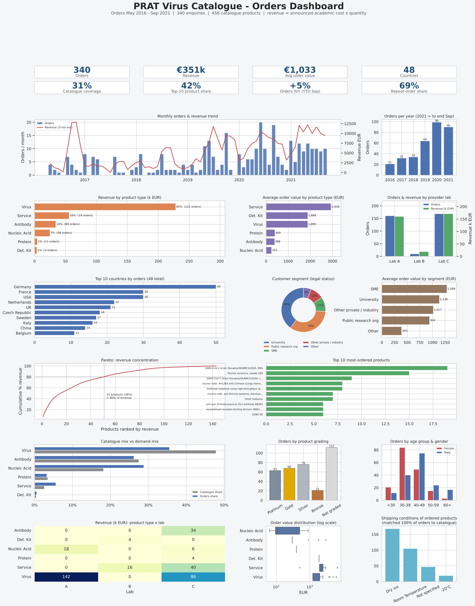

# PRAT Virus Catalogue: Orders Analysis & Dashboard

Python analysis of a virus biobank catalogue and its customer orders. The script cleans the raw Excel data, links orders to the catalogue, computes business KPIs and generates a one-page dashboard plus 16 individual charts.



## Project overview

The project uses two Excel datasets:

| File | Content | Size |
|---|---|---|
| `Exercice_PRAT_Orders.xlsx` | Customer enquiries (May 2016 to Sep 2021): provider lab, product type, product title, grading, announced cost, quantity, customer country, organisation type, gender, birth year | 340 rows |
| `Exercice_PRAT_Products.xlsx` | Catalogue items: provider lab, product type, title, virus, grading, shipping conditions | 462 rows (456 unique titles) |

**Goal:** understand what is ordered, by whom and where, and where the catalogue and demand diverge.

## Key KPIs

| KPI | Value |
|---|---|
| Orders | 340 (382 units) |
| Revenue (announced cost x quantity) | about EUR 351k |
| Average / median order value | EUR 1,033 / EUR 500 |
| Countries served | 48 |
| Catalogue coverage (products ordered at least once) | 31% |
| Revenue share of top 10 products | 42% |
| Revenue share of top lab (Lab A) | 49% |
| Orders from companies (SME + industry) | 21% |
| Orders on graded products | 67% |
| Orders growth, Jan-Sep 2021 vs Jan-Sep 2020 | +5% |

The full KPI table is written to `kpis.csv` when the script runs.

## Main findings

- **Growth then plateau:** orders rose from 21 in 2016 to 99 in 2020; 2021 (to end of September) is on a similar level with 90.
- **Virus products drive revenue:** 65% of revenue from 36% of orders (about EUR 1,885 per order). Antibodies and nucleic acids are frequent but cheap (about EUR 250 to 390 per order).
- **Catalogue and demand mismatch:** virus products are 48% of the catalogue but 36% of orders; nucleic acids and services are ordered more than their catalogue share.
- **Concentration:** about 51 products (36% of those ordered) generate 80% of revenue, while 69% of the catalogue was never ordered.
- **Customers:** Germany, France and the USA are the top countries. Universities and public research organisations place 74% of orders; SMEs pay the most per order.
- **Logistics:** dry ice is the most common shipping condition among ordered products.

## Repository structure

```
.
├── prat_dashboard.py     # full analysis script
├── dashboard.png         # one-page dashboard
├── kpis.csv              # KPI table
├── charts/               # 16 individual charts (PNG)
├── data/                 # place the two Excel files here
└── README.md
```

## Getting started

**Requirements:** Python 3.9+ and the following packages.

```bash
pip install pandas openpyxl matplotlib seaborn
```

**Run:**

```bash
python prat_dashboard.py data/Exercice_PRAT_Orders.xlsx data/Exercice_PRAT_Products.xlsx .
```

Arguments are optional and positional: orders file, products file, output folder. Defaults are the two file names in the current directory, and the current directory for output.

**Outputs:** `dashboard.png`, `kpis.csv` and `charts/*.png`.

## Method

1. **Import** both Excel files and standardise column names.
2. **Clean:** repair garbled characters in text (for example `Côte d'Ivoire`), shorten long labels, label missing grading as "Not graded" and missing host type as "Not specified".
3. **Check quality:** 12 exact duplicate rows are flagged (kept as repeat orders); orders are joined to the catalogue on product title and all 340 orders match.
4. **Define KPIs** (see assumptions below).
5. **Visualise** with matplotlib and seaborn: trends, product-type mix, country and segment breakdowns, Pareto curve, catalogue vs demand, grading, age and gender, shipping, lab x product-type heatmap and order value distribution.

## Assumptions and limitations

- **Revenue** is defined as announced academic cost x quantity. No invoiced amounts are available.
- **Distinct users and repeat-order share** are estimated from country, organisation type, gender and birth year, because there is no user ID.
- **Duplicates** are kept; remove them in the cleaning step if they are data-entry errors.
- **2021 is partial** (data ends 28 Sep 2021), so year-over-year growth compares the same Jan-Sep window.
- Personal fields (gender, birth year) are used only in aggregate.

## Charts included

Monthly trend, orders per year, orders and revenue by lab, revenue by product type, average order value by type, top countries, customer segments, average order value by segment, grading, catalogue vs demand mix, Pareto revenue concentration, top products, age and gender, shipping conditions, product type x lab heatmap, order value boxplot.

## Tech stack

Python, pandas, openpyxl, matplotlib, seaborn.

## Author

Kabenlachie Benedicta, https://www.linkedin.com/in/kabenlachie
